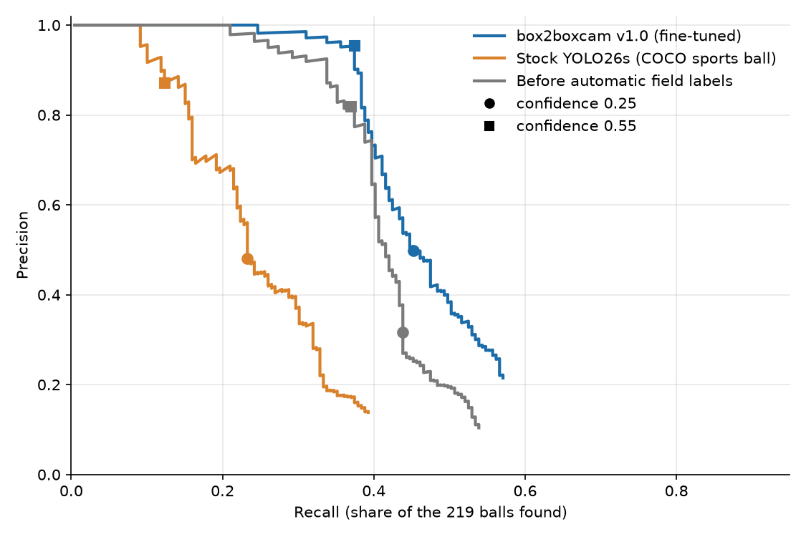
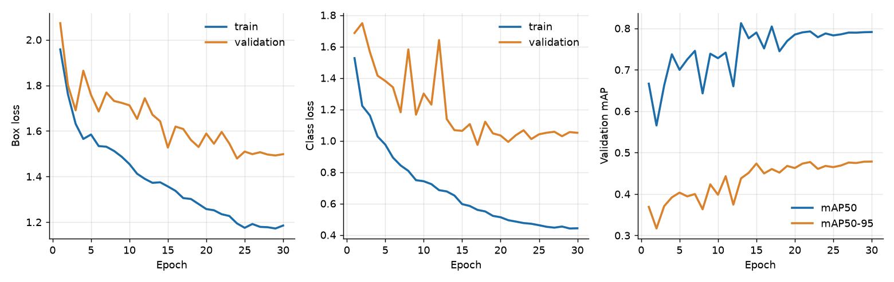

# box2boxcam: football (soccer) ball detection

box2boxcam: football (soccer) ball detection and an auto-tracking camera for amateur matches. A box-to-box midfielder covers the whole pitch, and the camera does the same with bounding boxes. An iPhone on a ~160 EUR DockKit gimbal films your amateur football match by itself, driven by a small YOLO ball detector: no subscription, and the gimbal stays useful for everything else. This repository holds the data, training and evaluation pipeline for the ball detector that drives the camera. The box2boxcam iOS app (Swift tracking, replay workshop; closed for now) lives in a separate repository.

> Demo: _GIF / video placeholder, to be added (`docs/media/demo.gif`)._

## How it works

On the phone, a small YOLO26 ball detector (Core ML) runs together with on-device person detection and body pose estimation, at about 30 Hz on an iPhone. A hybrid camera policy combines the ball track with where the players are (and a group guard that stays with the densest group of players when the ball is lost) and sends angular velocities to the gimbal through Apple's DockKit. This repository covers the detector side: building datasets, training, and measuring how well the ball is found. The policy is evaluated offline in the [camera-guidance benchmark](docs/camera_guidance_benchmark.md).

## Compatible hardware

DockKit gimbals confirmed by their maker (research of 13 Nov 2026; not legal or purchase advice):

| Device | DockKit | List price |
|---|---|---|
| DJI Osmo Mobile 8 | yes, native (iPhone 12+, iOS 18.5+) | 159 EUR (Nov 2025) |
| DJI Osmo Mobile 8P | yes | 159 / 189 / 219 EUR (May 2026) |
| Insta360 Flow 2 Pro | yes (iPhone 12+, iOS 17+) | 169.99 EUR RRP (Jan 2025) |
| Insta360 Flow Pro | yes (first DockKit gimbal, 2024) | EUR price not verified |
| Belkin Auto-Tracking Stand Pro (a stand, not handheld) | yes | $179.99 (Jan 2024) |

The author uses a DJI Osmo Mobile DockKit model. He bought it second-hand for 85 EUR and recommends buying used: with an iPhone you already own, the whole setup can cost under 100 EUR. Third-party DockKit control (`setAngularVelocity`) behaviour depends on the maker and iOS version; one developer-forum report says it did not work on the Osmo Mobile 8, so test on your own gimbal. Not DockKit: Insta360 Flow 2 (non-Pro), DJI Osmo Mobile 7P.

## Price comparison

Prices as of 13 November 2026, from the cited vendor or press pages; they change often.

| System | Price | Subscription |
|---|---|---|
| This approach (iPhone you own + DockKit gimbal) | 159-170 EUR list price for the gimbal | none |
| Veo Cam 3 | 899 EUR camera + 249 EUR tripod + 12-month plan, 1,747 EUR in total in a promotion that ended 28 May 2026 (current price not verified) | yes |
| XbotGo | Chameleon from $254.99, Falcon $769 (XbotGo store, USD) | none stated |
| Pix4Team 2 | from 799 EUR + 69 EUR/month, or 1,999 EUR one-off (reseller page) | optional |

Under 100 EUR does not exist at list price for DockKit gimbals; the closest are sales and second-hand units.

## Results

Reserved match, never used for training: 396 frames, 219 balls, 149 of them small (16 px or less). True/false positives at IoU >= 0.5, 960 px input (YOLO26 Small, [details](docs/mobile_auto_field_v006_20261111.md)):

| Confidence | v004 | v005 | v006 |
|---|---:|---:|---:|
| 0.25 | 95 / 203 | 97 / 136 | 100 / 103 |
| 0.35 | 93 / 113 | 93 / 101 | 93 / 60 |
| 0.45 | 89 / 64 | 88 / 61 | 86 / 30 |
| 0.55 | 81 / 23 | 82 / 16 | 81 / 3 |

v006 makes far fewer false boxes at equal recall; recall itself did not improve in a demonstrated way. **Recall on small, far balls is still under 50 %**: v006 finds 57 of the 149 small balls at 0.25. See [model sizes](docs/mobile_size_comparison_20261015.md) and [v004](docs/mobile_field_v004_20261014.md).

### Fine-tuning vs stock YOLO

The point of fine-tuning, measured on the same independent test split of the public dataset (396 frames, 219 balls, 149 of them 16 px or smaller; heads blurred). Stock YOLO26s is the COCO-pretrained model, keeping only the COCO class "sports ball" (class 32); box2boxcam v1.0 is the fine-tuned detector. Same tool (`scripts/evaluate_detector.py`), 960 px input, IoU >= 0.5, true / false positives per confidence threshold.

| Model | 0.25 | 0.35 | 0.45 | 0.55 | Recall / precision at 0.25 | Small balls found at 0.25 | Max TP at FP <= 25 / 60 / 100 / 200 |
|---|---:|---:|---:|---:|---:|---:|---:|
| Stock YOLO26s (COCO "sports ball") | 51 / 55 | 47 / 22 | 35 / 9 | 27 / 4 | 23 % / 48 % | 23 of 149 | 47 / 53 / 65 / 72 |
| Before automatic field labels | 96 / 207 | 93 / 113 | 88 / 61 | 81 / 18 | 44 % / 32 % | 54 of 149 | 85 / 88 / 92 / 96 |
| **box2boxcam v1.0** | **99 / 100** | **92 / 52** | **85 / 22** | **82 / 4** | **45 % / 50 %** | **55 of 149** | **86 / 93 / 99 / 111** |

Stock YOLO26s does find some balls: 51 of the 219 at confidence 0.25 (86 even at its lowest threshold of 0.05, with 536 false boxes), but it misses most of the small, far balls that matter on a sideline phone video. Fine-tuning roughly doubles the balls found at every threshold (99 against 51 at 0.25) and finds 55 of the 149 small balls against 23. A paired bootstrap over frames (2000 resamples, fine-tuned minus stock) gives +48 true positives at 0.25 (95 % interval +36 to +61), +55 at 0.55 (+41 to +69, with no change in false positives), and +34 to +40 true positives at every false-positive budget of 25 to 200 (all intervals exclude zero). Blurring heads barely matters: on the same frames unblurred, the fine-tuned model scores 100 / 103, 93 / 60, 86 / 30 and 81 / 3, and the stock model 56 / 57, 46 / 24, 35 / 11 and 27 / 3.



Precision against recall over all confidence thresholds on the test split. Circles mark confidence 0.25, squares 0.55.



Training curves of the released model (30 epochs): box and class loss on the training and validation sets, and validation mAP50 and mAP50-95 per epoch. The validation set is the one used during training (it shares its match with the training set), not the independent test split above.

## What did not work

Details in [docs/negative_results.md](docs/negative_results.md).

- WASB published ball weights: almost no extra balls at a usable false-positive level.
- 3-frame (9-channel) stacking: no gain beyond noise over a 3-channel control, 3x the GPU time.
- Gated low-threshold re-detection: +1 to +6 hits per recording, no net gain; most misses leave no candidate.
- Copy-paste of small balls into training images: no gain.
- A single-seed "gain" (mosaic + reduced scale) that did not replicate with another seed.

## Camera-guidance benchmark (SoccerTrack v2)

A closed-loop benchmark on SoccerTrack v2 panoramas (16 segments, 577 s, split into tuning/test/final before any result) measures how many players stay in frame and how far the frame centre is from the action. Headline: a fixed camera keeps the action under 3 players 29 % of the time; the current rule 2.2 %; the group guard 1.0 % (pooled), with distance to the action improving by 0.028 view-widths [-0.055, -0.001]. Caveat: the gain is not confirmed on the final segments alone. Body orientation is a weak group-direction signal (right sign only 60 % of the time), and replacing it with tracked velocity did not help. Full write-up: [docs/camera_guidance_benchmark.md](docs/camera_guidance_benchmark.md).

## Repository map

| Path | Content |
|---|---|
| `src/box2boxcam/data/` | dataset building, audits, annotation review tools |
| `src/box2boxcam/training/` | evaluation, camera-targeting scoring, teacher benchmarks |
| `src/box2boxcam/evaluation/` | held-out ball-detector evaluation: IoU matching, small-ball breakdown, false-positive budgets, paired bootstrap |
| `src/box2boxcam/camera_sim/`, `src/box2boxcam/benchmark/` | closed-loop camera simulation and the SoccerTrack v2 guidance benchmark |
| `scripts/` | Hugging Face Jobs training, evaluation, annotation and review scripts |
| `configs/` | dataset recipes, training configs, Label Studio templates |
| `notebooks/` | exploration and training notebooks (no outputs stored) |
| `tests/` | unit tests (temporary data, mocked clients) |
| `docs/` | results and methods, start at [docs/README.md](docs/README.md) |
| `data/`, `models/checkpoints/` | local only, git-ignored (see `data/README.md`) |

## Install

Python 3.11 or newer.

```sh
git clone https://github.com/Thibault-GILLARD/box2boxcam-football-vision
cd box2boxcam-football-vision
python3 -m venv .venv
source .venv/bin/activate
python -m pip install -e '.[dev]'                   # tests and lint only
python -m pip install -e '.[dev,training]'          # adds ultralytics, torch, OpenCV
python -m pip install -e '.[dev,benchmark]'         # adds SciPy for the camera benchmark
python -m pip install -e '.[annotation,notebook]'   # OpenAI client, JupyterLab, plots
cp .env.example .env                                # then fill in keys locally
```

Annotation and remote-training scripts call paid services; the tests do not.

## Reproduce

```sh
python -m unittest discover -s tests
python -m ruff check .

python -m box2boxcam.data.list_sources                          # registered data sources
python scripts/mobile_training_hf.py prepare --config configs/mobile_small_auto_field_v006_960.json
python scripts/mobile_training_hf.py launch  --config configs/mobile_small_auto_field_v006_960.json   # paid HF Job
python scripts/mobile_training_hf.py collect --config configs/mobile_small_auto_field_v006_960.json
python scripts/evaluate_mobile_personal.py --output models/reports/my_eval

# held-out ball-detector evaluation (TP/FP, small balls, FP budgets, bootstrap A - B)
python scripts/evaluate_detector.py --weights new.pt --compare reference.pt \
    --frames-dir heldout/images --labels heldout/labels --out-json report.json

# camera-guidance benchmark on SoccerTrack v2 (data and models are not included)
python scripts/run_camera_benchmark.py --soccertrack-root soccertrack-v2 --set REF \
    --variants current guard --out runs/camera/ref.json \
    --people-weights yolo26s.pt --pose-weights yolo26s-pose.pt --ball-weights ball.pt
```

Labels for `evaluate_detector.py` are a directory of YOLO `.txt` files or a JSON file of pixel boxes (layouts in `src/box2boxcam/evaluation/ground_truth.py`). Getting SoccerTrack v2 (gated, CC BY 4.0), the expected folder layout, metric definitions and caveats are in [docs/camera_guidance_benchmark.md](docs/camera_guidance_benchmark.md).

Public targets: model `Totorotibo84/box2boxcam-football-ball-detection`, dataset `Totorotibo84/box2boxcam-football-ball-detection-dataset`. The `configs/mobile_*.json` files still point to the author's existing private Hugging Face repos (`pitchlens-*`, kept so those artefacts stay reachable).

Training needs the datasets, which are published separately (see below), and a Hugging Face token in `.env`. The reserved-match protocol is in [docs/field_validation_20261021.md](docs/field_validation_20261021.md); the reserved frames must never enter training.

## Data provenance and privacy

- Own footage (amateur matches filmed with an iPhone), faces blurred before publication. Folder names such as `club_match_*` are session labels of this footage.
- Third-party clips are referenced by URL only (`configs/video_download_sources.json`); they are never redistributed.
- The `luna_v001` frames (1,120 images) come from one YouTube video, <https://www.youtube.com/watch?v=vL0r9ek1nqQ>. Source stated by the owner, not re-verified; redistribution rights are not cleared, so only annotations and this URL are published, never frames or the video.
- Public datasets used: see [docs/dataset_assessment.md](docs/dataset_assessment.md).
- Frames were sent to third-party model APIs (the `gpt-6-luna` multimodal model, and Claude for judging candidates) to propose ball boxes. These proposals are not ground truth; human review is described in the docs.

Players in the footage may be identifiable. Do not republish raw frames without consent.

## Roadmap

- Raise recall on small, far balls without adding false positives.
- Replace body-orientation direction by a tracked-velocity signal used to confirm or end persistence, and re-test on fresh held-out segments.
- Off-pitch spare-ball filter in the app; Core ML export of the next model.
- Demo video, public datasets and weights, and publishing under the final project name.

## Licensing

- **Code and trained weights: AGPL-3.0** (see [LICENSE](LICENSE)). The training code depends on [Ultralytics](https://github.com/ultralytics/ultralytics) (AGPL-3.0), which extends to the models it produces.
- **Dataset annotations and the author's own images: CC BY 4.0**, published separately.
- **SoccerTrack v2** (CC BY 4.0) is used for the benchmark; credit below.
- Third-party video is never redistributed.

Not legal advice.

## Citation and acknowledgements

SoccerTrack v2: Scott et al., arXiv:2508.01802, https://github.com/AtomScott/SoccerTrack-v2 (dataset CC BY 4.0, code MIT). Detectors are fine-tuned YOLO26 models from Ultralytics.

## The box2boxcam project

- Model: https://huggingface.co/Totorotibo84/box2boxcam-football-ball-detection
- Dataset: https://huggingface.co/datasets/Totorotibo84/box2boxcam-football-ball-detection-dataset
- Code: https://github.com/Thibault-GILLARD/box2boxcam-football-vision

If this is useful to you, a star or a like is very welcome, and so is a message; issues and pull requests are warmly invited.
