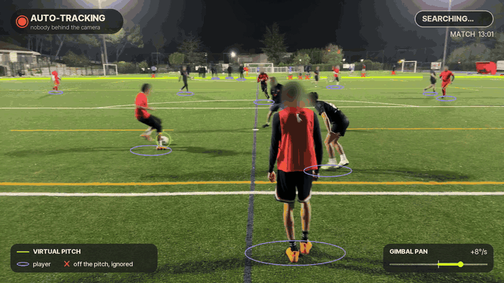
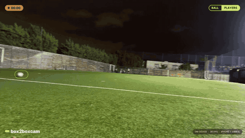
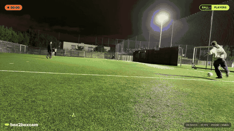
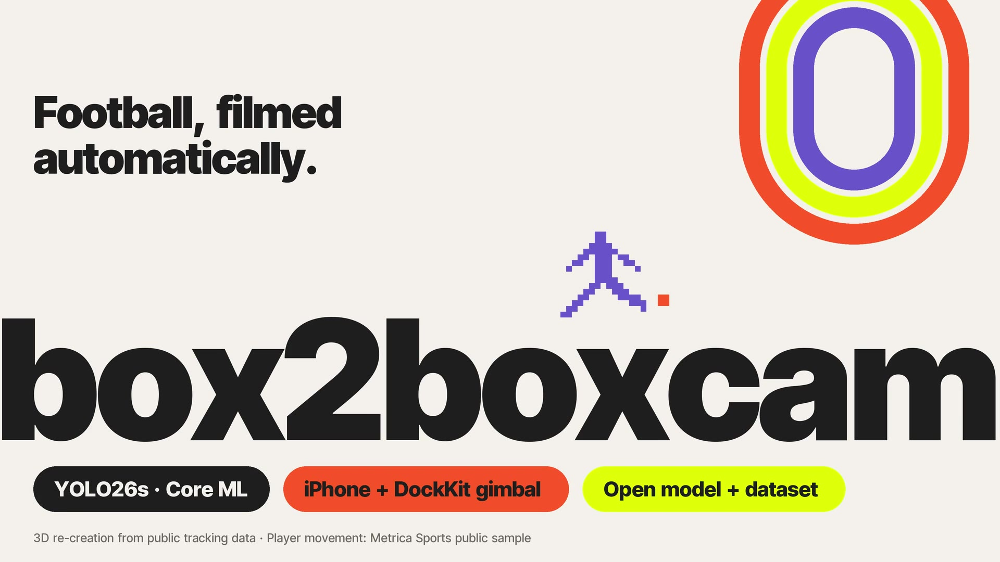

# box2boxcam: football (soccer, if you must) ball detection

box2boxcam turns an iPhone on a ~160 EUR phone gimbal into the cameraman of your amateur match. Everything runs on the phone:

1. **Find the ball**: a small YOLO26 model, fine-tuned to spot the ball even when it is a few pixels wide, at night.
2. **Pick where to film**: a hybrid rule follows the ball and the players, so the play stays in frame when the ball is hidden.
3. **Move the camera**: the phone drives the gimbal's motors and pans like a cameraman would.

No subscription, and the gimbal stays useful for everything else. A box-to-box midfielder covers the whole pitch; the camera does the same with bounding boxes.

https://github.com/user-attachments/assets/841d7093-8ea7-4c0e-b87a-2b174dd26b50

<p align="center">
  
</p>

A real night match, nobody behind the camera (faces blurred). The ball ring comes from the phone's log; the pitch outline and player markers were drawn afterwards to show which people count.

<p align="center">
  
  
</p>

Solo training: ball (yellow) and player pose (violet), drawn afterwards with the same ball model and a stock YOLO26s-pose.

<p align="center">
  <a href="docs/assets/box2boxcam-presentation.mp4"></a>
</p>

## What you get

- **Model**: box2boxcam v1.0, YOLO26s fine-tuned at 960 px, PyTorch and Core ML. [Hugging Face model](https://huggingface.co/Totorotibo84/box2boxcam-football-ball-detection) (AGPL-3.0).
- **Dataset**: annotated frames with a reserved test split, faces and heads blurred. [Hugging Face dataset](https://huggingface.co/datasets/Totorotibo84/box2boxcam-football-ball-detection-dataset) (CC BY 4.0 for the author's own images and annotations).
- **Code** (this repository): dataset building, training on Hugging Face Jobs, held-out evaluation, and a closed-loop camera-guidance benchmark. Unit tests run without any data or network.
- **App**: the box2boxcam iOS app (tracking and gimbal control in Swift) is still in development, tested on real matches, and lives in a separate private repository for now. On the phone the ball detector (Core ML) runs next to person detection and pose estimation at about 30 Hz.

## Hardware and cost

The gimbal must let an app move its motors, which on iPhone means it supports DockKit (Apple's gimbal-control API). Gimbals confirmed by their maker (research of 13 Nov 2026; not legal or purchase advice). Prices as of 13 November 2026 and they change often.

| Device | App control (DockKit) | List price |
|---|---|---|
| DJI Osmo Mobile 8 | yes, native (iPhone 12+, iOS 18.5+) | 159 EUR (Nov 2025) |
| DJI Osmo Mobile 8P | yes | 159 / 189 / 219 EUR (May 2026) |
| Insta360 Flow 2 Pro | yes (iPhone 12+, iOS 17+) | 169.99 EUR RRP (Jan 2025) |
| Belkin Auto-Tracking Stand Pro (a stand, not handheld) | yes | $179.99 (Jan 2024) |

Not DockKit: Insta360 Flow 2 (non-Pro), DJI Osmo Mobile 7P. Third-party control of the gimbal (`setAngularVelocity`) depends on the maker and iOS version, and one developer-forum report says it did not work on the Osmo Mobile 8: test on your own gimbal.

The author bought a second-hand DJI Osmo Mobile for 85 EUR and recommends buying used: with an iPhone you already own, the whole setup can cost under 100 EUR (not at list price).

| System | Price | Subscription |
|---|---|---|
| This approach (iPhone you own + phone gimbal) | 159-170 EUR list price for the gimbal | none |
| Veo Cam 3 | 1,747 EUR in total (899 EUR camera + 249 EUR tripod + 12-month plan); figure from a promotion that ended 28 May 2026, current price not verified | yes |
| XbotGo | Chameleon from $254.99, Falcon $769 (XbotGo store, USD) | none stated |
| Pix4Team 2 | from 799 EUR + 69 EUR/month, or 1,999 EUR one-off (reseller page) | optional |

## Results

Test split of the public dataset, never used for training: 396 frames, 219 balls, 149 of them small (16 px or less). Stock YOLO26s is the COCO-pretrained model keeping only the class "sports ball". Same tool (`scripts/evaluate_detector.py`), 960 px input, IoU >= 0.5, true / false positives per confidence threshold.

| Model | 0.25 | 0.35 | 0.45 | 0.55 | Recall / precision at 0.25 | Small balls found at 0.25 | Max TP at FP <= 25 / 60 / 100 / 200 |
|---|---:|---:|---:|---:|---:|---:|---:|
| Stock YOLO26s | 51 / 55 | 47 / 22 | 35 / 9 | 27 / 4 | 23 % / 48 % | 23 of 149 | 47 / 53 / 65 / 72 |
| First field model (before automatic field labels) | 96 / 207 | 93 / 113 | 88 / 61 | 81 / 18 | 44 % / 32 % | 54 of 149 | 85 / 88 / 92 / 96 |
| **box2boxcam v1.0** | **99 / 100** | **92 / 52** | **85 / 22** | **82 / 4** | **45 % / 50 %** | **55 of 149** | **86 / 93 / 99 / 111** |

Stock YOLO26s finds some balls (51 of 219 at 0.25) but misses most small, far ones. Fine-tuning roughly doubles the balls found at every threshold and finds 55 of the 149 small balls against 23. A paired bootstrap over frames (2000 resamples, fine-tuned minus stock) gives +48 true positives at 0.25 (95 % interval +36 to +61) and +34 to +40 at every false-positive budget from 25 to 200; all intervals exclude zero. Against the first field model, v1.0 removes about half the false boxes (207 to 100 at 0.25) at equal recall.


Circles mark confidence 0.25, squares 0.55. Training curves (30 epochs) are in [docs/assets/training_curves.png](docs/assets/training_curves.png); their validation set shares a match with the training set, so they are not the independent test above.

**Honest limits.** Fewer than half the balls are found: recall on small, far balls is still under 50 %, and most misses leave no candidate at all. A control retrain with another seed gave 7 to 17 more false positives at 0.25 to 0.45, so treat small differences as noise. One test match, one stadium. Blurring heads barely matters (unblurred frames: 100 / 103 at 0.25 for v1.0, 56 / 57 for stock). The Core ML export's accuracy and on-phone speed of the detector alone were not measured. Longer write-ups: [docs/mobile_auto_field_v006_20261111.md](docs/mobile_auto_field_v006_20261111.md), [model sizes](docs/mobile_size_comparison_20261015.md).

## Camera-guidance benchmark

A closed-loop benchmark on SoccerTrack v2 panoramas (16 segments, 577 s, split into tuning / test / final before any result) measures how many players stay in frame and how far the frame centre is from the action. A fixed camera keeps the action under 3 players 29 % of the time; the current rule 2.2 %; the group guard 1.0 % (pooled), with distance to the action improving by 0.028 view-widths [-0.055, -0.001]. Caveat: the gain is not confirmed on the final segments alone. Body orientation is a weak group-direction signal (right sign 60 % of the time), and tracked velocity did not help. Details: [docs/camera_guidance_benchmark.md](docs/camera_guidance_benchmark.md).

## What did not work

Details in [docs/negative_results.md](docs/negative_results.md).

- WASB published ball weights: almost no extra balls at a usable false-positive level.
- Three stacked frames (9-channel input): no gain beyond noise over a 3-channel control, 3x the GPU time.
- Gated low-threshold re-detection: +1 to +6 hits per recording, no net gain.
- Copy-paste of small balls into training images: no gain.
- A scale-augmentation "gain" with seed 42 that did not replicate with seed 7.

## Quick start

Python 3.11 or newer.

```sh
git clone https://github.com/Thibault-GILLARD/box2boxcam-football-vision
cd box2boxcam-football-vision
python3 -m venv .venv && source .venv/bin/activate
python -m pip install -e '.[dev,training]'   # adds ultralytics, torch, OpenCV
python -m unittest discover -s tests && python -m ruff check .
```

Run the detector on a video (weights downloaded from the model repository):

```sh
python - <<'EOF'
from huggingface_hub import hf_hub_download
from ultralytics import YOLO
w = hf_hub_download("Totorotibo84/box2boxcam-football-ball-detection", "box2boxcam-ball-v1.0.pt")
YOLO(w).predict("match.mp4", imgsz=960, conf=0.25, save=True)
EOF
```

Evaluate any detector on your own labelled frames (YOLO `.txt` files or a JSON of pixel boxes, see `src/box2boxcam/evaluation/ground_truth.py`; `--compare` adds a paired bootstrap):

```sh
python scripts/evaluate_detector.py --weights new.pt --compare reference.pt \
    --frames-dir heldout/images --labels heldout/labels --out-json report.json
```

## Reproduce and train

Training uses a paid Hugging Face Job (about 1 USD per run for a model like v1.0), a Hugging Face token in `.env`, and the datasets, which are not in this repository (`data/` is git-ignored). The `configs/mobile_*.json` files name the author's private Hugging Face repositories; replace the repository ids with your own.

```sh
cp .env.example .env                       # fill in keys locally
python -m box2boxcam.data.list_sources     # registered data sources
python scripts/mobile_training_hf.py prepare --config configs/mobile_small_auto_field_v006_960.json
python scripts/mobile_training_hf.py launch  --config configs/mobile_small_auto_field_v006_960.json
python scripts/mobile_training_hf.py collect --config configs/mobile_small_auto_field_v006_960.json
```

`mobile_small_auto_field_v006_960.json` is the recipe of box2boxcam v1.0 (`v006` is only its internal id; the [vocabulary](docs/README.md#vocabulary) lists the others). The reserved-match protocol is in [docs/field_validation_20261021.md](docs/field_validation_20261021.md); reserved frames must never enter training. Figures: `scripts/make_report_figures.py`.

Camera benchmark (SoccerTrack v2 is gated, CC BY 4.0, not included; layout and metrics in [docs/camera_guidance_benchmark.md](docs/camera_guidance_benchmark.md)):

```sh
python -m pip install -e '.[benchmark]'
python scripts/run_camera_benchmark.py --soccertrack-root soccertrack-v2 --set REF \
    --variants current guard --out runs/camera/ref.json \
    --people-weights yolo26s.pt --pose-weights yolo26s-pose.pt --ball-weights ball.pt
```

Repository map: `src/box2boxcam/` (data, training, evaluation, camera simulation, benchmark), `scripts/`, `configs/`, `notebooks/` (exploration, no outputs stored), `tests/`, `docs/` (start at [docs/README.md](docs/README.md)).

## Data provenance and privacy

- Own footage: amateur matches filmed with an iPhone, heads and faces blurred before publication. Small far heads may remain and players can still be recognisable by other cues; do not republish raw frames without consent.
- Third-party clips are referenced by URL only and never redistributed. One YouTube video supplied 1,120 frames, source stated by the owner and not re-verified; only annotations and the URL are published.
- Ball boxes were proposed by third-party model APIs (frames were sent to them) and then reviewed by a human; proposals are not ground truth.
- To have an image removed, [open an issue](https://github.com/Thibault-GILLARD/box2boxcam-football-vision/issues/new) and it will be taken down promptly.

## Licensing

- **Code and trained weights: AGPL-3.0** ([LICENSE](LICENSE)). The training code depends on [Ultralytics](https://github.com/ultralytics/ultralytics) (AGPL-3.0), which extends to the models it produces.
- **Dataset annotations and the author's own images: CC BY 4.0**, published separately.
- **SoccerTrack v2** (CC BY 4.0) is used for the benchmark; third-party video is never redistributed.

Not legal advice.

## Citation

```bibtex
@software{gillard2026box2boxcam,
  author  = {Gillard, Thibault},
  title   = {box2boxcam: football (soccer) ball detection and auto-tracking camera for amateur matches},
  year    = {2026},
  url     = {https://github.com/Thibault-GILLARD/box2boxcam-football-vision},
  license = {AGPL-3.0}
}
```

See also [CITATION.cff](CITATION.cff). Benchmark data: Scott et al., SoccerTrack v2, [arXiv:2508.01802](https://arxiv.org/abs/2508.01802). Detectors are fine-tuned YOLO26 models from Ultralytics. Contributions: [CONTRIBUTING.md](CONTRIBUTING.md).

## The box2boxcam project

- Model: https://huggingface.co/Totorotibo84/box2boxcam-football-ball-detection
- Dataset: https://huggingface.co/datasets/Totorotibo84/box2boxcam-football-ball-detection-dataset
- Code: https://github.com/Thibault-GILLARD/box2boxcam-football-vision

If this is useful to you, a star or a like is very welcome, and so is a message; issues and pull requests are warmly invited.
